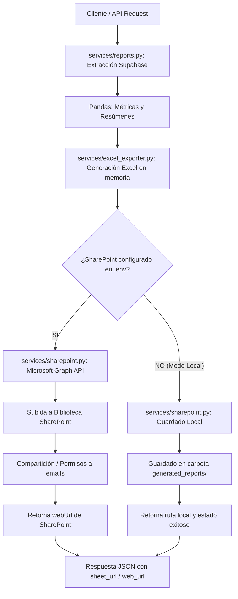

# Contexto General: Migración de Reportes a Excel / SharePoint y Despliegue en Docker / VM

Este documento recopila de manera integral el análisis, la arquitectura técnica implementada, las decisiones de diseño, la dockerización y los procedimientos de despliegue realizados en el proyecto.

---

## 1. Diagnóstico del Sistema Original (Google Sheets)

### 1.1. Flujo Anterior
El sistema generaba reportes operativos y de distribución mediante el siguiente circuito:
1. **Base de Datos**: Consultas a procedimientos almacenados en PostgreSQL alojado en **Supabase** (`get_trucks_control`, `get_vehicle_control`, `get_order_information`, `report_loading_distribution`, `report_loading_distribution_interval`, `load_report_by_month_and_year`).
2. **Transformación**: Conversión a `pandas.DataFrame`, cálculo de métricas de tiempos en minutos (`tiempo_espera`, `tiempo_cargue`, `tiempo_conteo`, etc.) y tablas dinámicas en `analyze_distribution_times`.
3. **Exportación a Google Sheets**: Mediante `services/gsheets.py`, autenticaba con una cuenta de servicio (`controlio-a9a2e-aa2f420e4eaa.json`) usando `gspread` y `gspread_dataframe`.
4. **Compartición**: Otorgaba permisos de edición a la lista de correos `emails` y retornaba `sheet.url`.
5. **Endpoints**: Expuestos en `main.py` (`/make_report_control/`, `/make_report_vehicle/`, etc.) y en `routes/reports.py`.

### 1.2. Hallazgos Identificados
- Dependencia acoplada a la API de Google Drive y Sheets.
- Un bug en `fetch_load_report_driver_by_month` que llamaba a `dataframes_to_google_sheets` omitiendo el parámetro obligatorio `worksheet_titles`.

---

## 2. Nueva Arquitectura Desacoplada: Excel (.xlsx) y Microsoft SharePoint

Para permitir que el sistema funcione de inmediato sin obligar a que SharePoint esté configurado el primer día, se implementó una **arquitectura desacoplada en capas**:



---

## 3. Módulos y Cambios Realizados en el Código

### 3.1. Entorno Virtual y Dependencias
- Se configuró el entorno virtual en `.venv/` con Python 3.10.
- Se agregó `openpyxl` a `requirements.txt` para escritura nativa de archivos `.xlsx`.

### 3.2. Configuración y Variables de Entorno
- **`settings.py`**: Se agregaron las variables de entorno para Microsoft Azure AD y SharePoint:
  - `AZURE_TENANT_ID`, `AZURE_CLIENT_ID`, `AZURE_CLIENT_SECRET`
  - `SHAREPOINT_SITE_ID`, `SHAREPOINT_DRIVE_ID`, `SHAREPOINT_FOLDER_PATH`
  - `LOCAL_REPORTS_DIR` (por defecto `generated_reports`)
- **`.env.example`**: Archivo plantilla con la documentación paso a paso para configurar Azure AD (Entra ID) y SharePoint.
- **`helpers/db_supabase.py`**: Inicialización segura para que el servidor no falle al importar el módulo si las credenciales de base de datos no están definidas localmente.

### 3.3. Nuevos Servicios
1. **`services/excel_exporter.py`**:
   - `dataframe_to_excel_buffer`: Genera un archivo `.xlsx` en memoria (`io.BytesIO`) para un solo DataFrame.
   - `dataframes_to_excel_buffer`: Genera libros con múltiples hojas con deduplicación de nombres.
   - `sanitize_sheet_name`: Limpia caracteres no admitidos por Excel (`[ ] * ? : / \`) y limita a 31 caracteres.
   - `autofit_columns`: Autoajusta el ancho de columnas automáticamente.
   - `save_excel_to_disk`: Permite persistir en almacenamiento físico.

2. **`services/sharepoint.py`**:
   - `is_configured()`: Determina dinámicamente si las variables de SharePoint están listas en `.env`.
   - `get_access_token()`: Autenticación OAuth2 Client Credentials con caché en memoria.
   - `upload_file()`: Carga binaria directa a la biblioteca de documentos en SharePoint.
   - `share_file_with_emails()`: Otorga permisos directos vía `/invite` a las direcciones de correo.
   - `create_sharing_link()`: Genera enlaces compartidos organizacionales vía `/createLink`.
   - `export_and_deliver()`: Orquestador híbrido que envía a SharePoint si está activo o almacena en `generated_reports/` si está en modo local.

3. **`services/reports.py`**:
   - Se migraron las 6 funciones de reportes al nuevo flujo:
     - `fetch_trucks_control`
     - `fetch_vehicle_control`
     - `fetch_order_information`
     - `fetch_loading_distribution`
     - `fetch_loading_distribution_interval` (Múltiples pestañas: Datos, Resumen Carrocería, Resumen Carga)
     - `fetch_load_report_driver_by_month` (Múltiples pestañas y corrección del bug original de títulos).
   - Se mantiene retrocompatibilidad en la respuesta: el objeto retornado contiene tanto `sheet_url` (para clientes anteriores) como `web_url`, `file_name`, `storage` y `local_path`.

---

## 4. Pruebas y Validación

1. **Pruebas Unitarias (`scratch/test_reports_migration.py`)**:
   - Validó sanitización de nombres de hojas, generación de Excel simple, libro multi-pestaña con `openpyxl` y guardado local. Todo pasó al 100%.
2. **Prueba End-to-End (`scratch/test_pipeline_end_to_end.py`)**:
   - Simuló llamadas a Supabase y ejecutó el pipeline completo de reportes, generando archivos reales en `generated_reports/`.
3. **Validación de la Aplicación**:
   - Se validó que `main.py` y `routes/reports.py` cargan e inician sin errores de importación.

---

## 5. Dockerización

Se crearon los archivos para empaquetar la solución en un contenedor Linux listo para producción:

### 5.1. `Dockerfile`
- **Base**: `python:3.10-slim`.
- **Dependencias del Sistema**:
  - Microsoft ODBC Driver 17 (`msodbcsql17`), `unixodbc`, `freetds` para la conexión de `pyodbc` con SQL Server.
  - Librerías gráficas para OpenCV (`libgl1`, `libglib2.0-0`).
  - Utilidad `wkhtmltopdf` para generación de PDFs con `pdfkit`.
- **Ejecución**: Servidor ASGI Uvicorn escuchando en el puerto 8000 (o variable `$PORT` en entornos cloud).

### 5.2. `.dockerignore`
- Excluye `.venv`, `.git`, archivos `.env`, credenciales temporales y reportes locales para garantizar una imagen limpia y liviana.

---

## 6. Procedimientos de Despliegue en Máquina Virtual (VM)

### 6.1. Manejo de Secretos y GitHub Push Protection
GitHub bloquea por seguridad cualquier commit que contenga archivos de credenciales privadas (como `controlio-a9a2e-aa2f420e4eaa.json`).
- **Buena Práctica**: Mantener los archivos de claves confidenciales fuera de Git (en `.gitignore`) y transferirlos de forma directa y segura a la máquina virtual vía SCP o SFTP.

### 6.2. Transferencia Segura con SCP (PowerShell -> VM Linux)
Para copiar archivos confidenciales a una máquina virtual con un puerto SSH no estándar:
```powershell
# Sintaxis correcta con puerto personalizado (-P mayúscula):
scp -P 4223 controlio-a9a2e-aa2f420e4eaa.json asogano@192.168.105.40:~/
```

### 6.3. Ubicación del Archivo en la VM Linux
Cuando el archivo se sube a la carpeta personal del usuario (`/home/asogano/`), y se requiere moverlo a la ruta de producción como usuario `root`:
```bash
# Estando en /home/asogano (no usar ~ porque en root ~ representa /root):
mv /home/asogano/controlio-a9a2e-aa2f420e4eaa.json /var/www/apis/api_zeus_v2/Middleware_la_clay/

# Verificar existencia y permisos:
ls -l /var/www/apis/api_zeus_v2/Middleware_la_clay/controlio-a9a2e-aa2f420e4eaa.json
```

---

## 7. Pasos Futuros para Conectar SharePoint

Cuando se cree el sitio en SharePoint y la App Registration en Azure AD:
1. Crear un archivo `.env` en la raíz del proyecto (basado en `.env.example`).
2. Completar las variables:
   ```ini
   AZURE_TENANT_ID=xxxx-xxxx-xxxx
   AZURE_CLIENT_ID=yyyy-yyyy-yyyy
   AZURE_CLIENT_SECRET=zzzz~zzzz
   SHAREPOINT_SITE_ID=dominio.sharepoint.com,site-id,web-id
   SHAREPOINT_FOLDER_PATH=Reportes
   ```
3. El sistema cambiará automáticamente de guardar los archivos localmente a subirlos y compartirlos en SharePoint sin requerir modificaciones de código.
